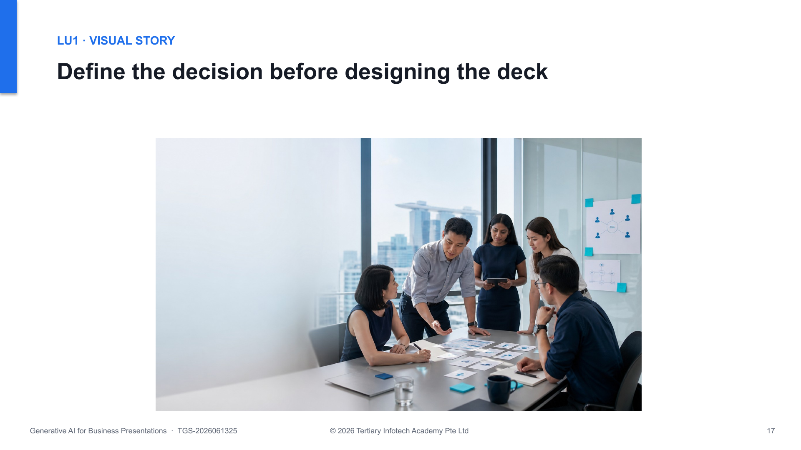

# Generative AI for Business Presentations

WSQ courseware for **TGS-2026061325**, aligned to **Business Presentation Delivery (TAC-BIN-5077-1.1, Level 5)**.

## Courseware

- 132-slide visual trainer deck in editable PowerPoint and PDF formats
- Detailed Learner Guide in DOCX and PDF formats
- 16-hour Lesson Plan with current slide-number mappings in DOCX and PDF formats
- Eight connected, self-contained activity folders using the Meridian Foods ReadyWise business scenario
- Each activity includes detailed instructions, a printable checklist, and an editable worked-example PowerPoint

The deck teaches presentation principles, business storytelling, visual evidence, delivery, Q&A, negotiation, review, and responsible AI-assisted production. Detailed software procedures are kept in the Learner Guide and activity packs rather than on the slides.

## Activity sequence

1. Decision-Ready Presentation Brief — PowerPoint and Claude
2. AI Tool Fit and Risk Matrix — Canva, Gamma, Napkin, Copilot and PowerPoint
3. Executive Story Spine — Claude or Microsoft 365 Copilot
4. AI Draft-to-Deck Design Studio — PowerPoint/Copilot, Canva, Gamma, Adobe Express, Presenton, Manus, QuillBot and Prezent
5. Evidence-to-Visual Upgrade — Napkin with PowerPoint or Canva
6. Delivery and Q&A Rehearsal — PowerPoint Presenter View and Microsoft 365 Copilot
7. Negotiation Deck Challenge — Claude and PowerPoint
8. Presentation Review and Improvement Sprint — PowerPoint, Canva, Claude or Microsoft 365 Copilot

## Publication boundary

Assessment instruments and answer keys are confidential and intentionally excluded from this public repository. Candidate question papers are published only through the approved learner-facing system; answer keys remain trainer-only.

See [SOURCE-COVERAGE-v2.0.md](SOURCE-COVERAGE-v2.0.md) for research provenance and [QA-REPORT-v2.0.md](QA-REPORT-v2.0.md) for release checks.

